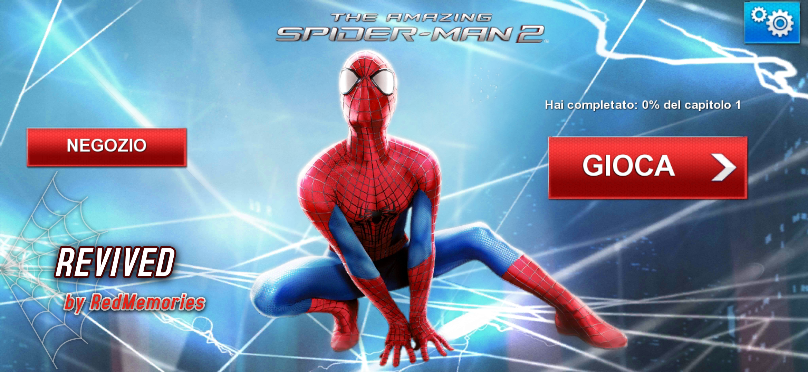
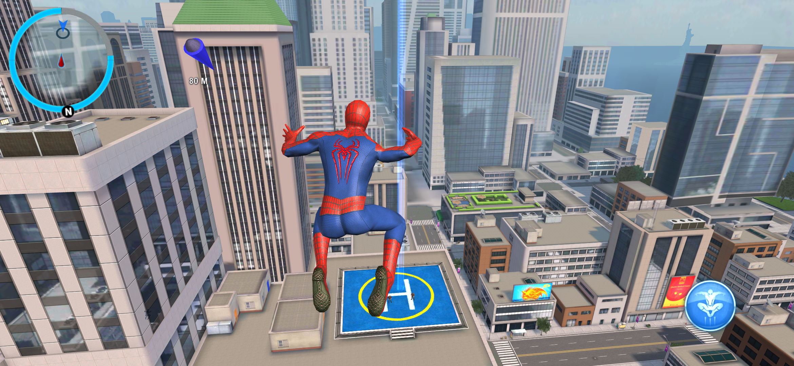
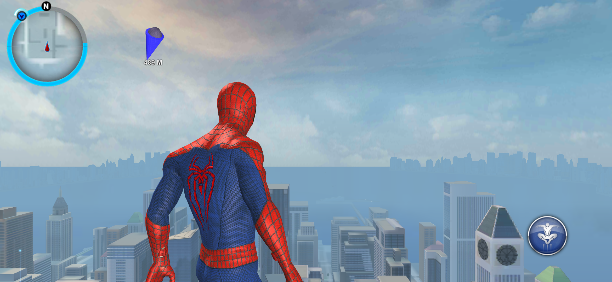
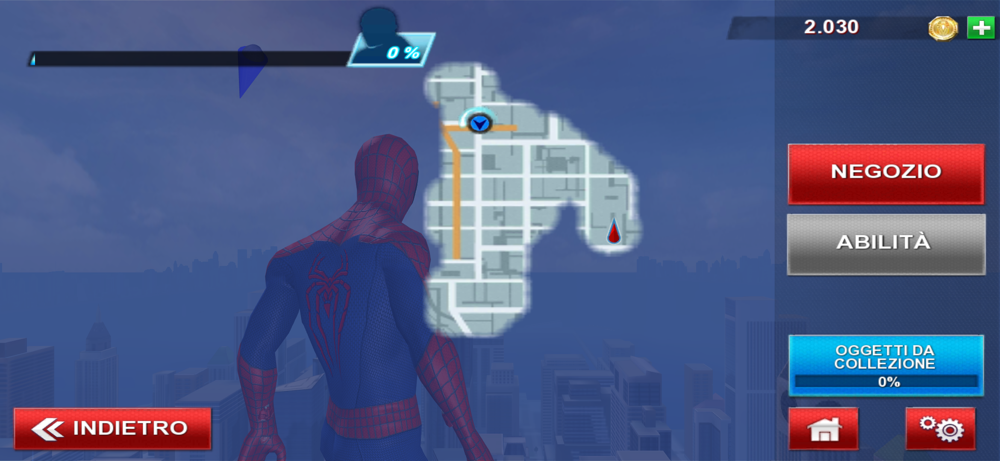

# The Amazing Spider-Man 2 Revived

> Spider-Man is a trademark of Marvel. The Amazing Spider-Man 2 mobile game is by Gameloft. This is a non-commercial fan project, not affiliated with Marvel, Sony or Gameloft. The game was pulled from the stores years ago. This repo is my private archive, please don't share the release files.

## What I did

I didn't remake the game and I didn't touch the gameplay. The city, the missions and the story are exactly the ones from 2014.

This time I went one step further than with the first game. Instead of translating the old 32-bit engine on the fly while you play, I converted the whole engine to native 64-bit code ahead of time: more than 46,000 functions, recompiled for today's phones. The game simply runs as a modern app, and it's faster for it.

Once it was running, I gave it the treatment it deserves on a modern phone:

- full screen on today's tall displays, edge to edge
- native resolution with 4x anti-aliasing, so edges are clean instead of jagged
- the highest graphics profile: the game didn't recognize modern GPUs and fell back to low-end settings, now it always uses the full one, with high resolution textures
- sharper textures, especially roads and buildings seen at an angle
- 60 fps instead of the original 30, with the game speed and the slow-motion quick time events still right
- the pause menu map now opens in the right place on wide screens instead of hiding behind the buttons

All the suits are unlocked from the start: Iron Spider, Scarlet Spider, Superior, Symbiote, Ultimate Comics, Future Foundation and End of the World. If you'd rather earn them, choose "Reset game progress" in the options: the game starts over and the suits have to be unlocked again, like in the original.

I also cleaned up everything that was left over from Gameloft's online stuff. The game is now fully offline, with no ads and no tracking, and it doesn't ask for any permission. The buttons that sent you to services that don't exist anymore (Gameloft Connect and LIVE, Google Play Games, friends and online events, sharing, support pages) are gone. The old downloader and the Google Play license check, which can't work anymore, are gone too: the game data is packed inside the APK, so there's nothing to download separately.

The game has its own built-in controller support. I couldn't test it with a modern controller yet: if you play with one, let me know if it works.

## Install

1. Download the APK from **Releases**
2. Install it
3. Open it. The first launch takes a little while to unpack the game, after that it starts right away

No PC, no extra downloads, no account.

## Requirements

- 64-bit Android phone with Android 10 or newer
- about 3 GB of free space

I play it on a Galaxy S26 Ultra with Android 16. I haven't tried it on phones without a Snapdragon chip yet (MediaTek Dimensity, Exynos, Google Tensor): if you play on one of them, let me know how it runs.

## Credits

Revived by **RedMemories**

Thanks to the [dynarmic](https://github.com/azahar-emu/dynarmic) project: its ARM decoder is the base of the recompiler, and it still runs the few bits of the engine that aren't recompiled.

Original game by Gameloft.
